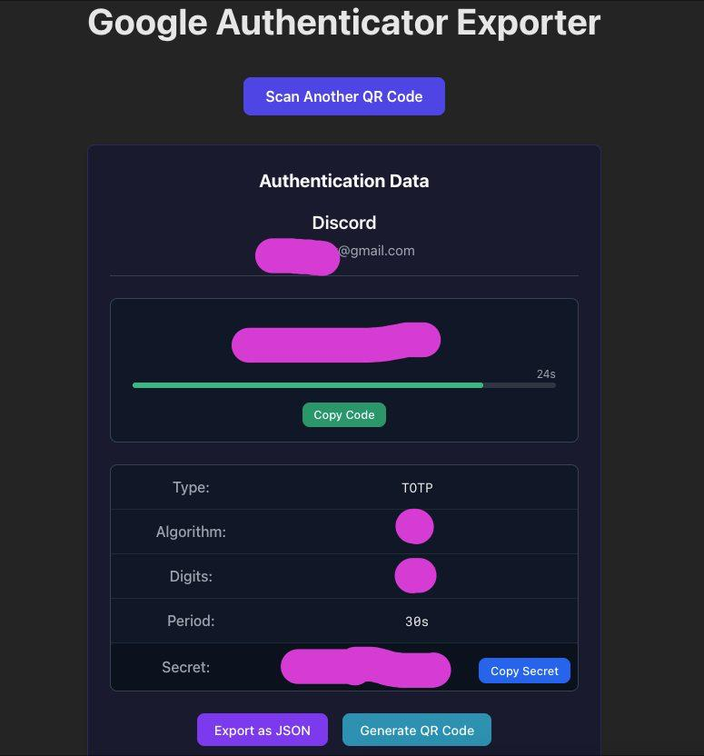

# Google Authenticator Exporter

<div align="center">
  
</div>

A powerful, user-friendly web application that allows you to scan, decode, and export Google Authenticator QR codes. This tool is perfect for migrating your 2FA tokens between devices or creating backups of your authentication secrets.

## ✨ Features

- 📱 **Scan QR Codes**: Directly scan QR codes using your device's camera
- 📂 **Auto-load from `data/`**: Loads saved JSON exports automatically on startup, without scanning a QR code
- 🔄 **Migration Support**: Process Google Authenticator migration QR codes containing multiple accounts
- 📊 **TOTP/HOTP Support**: Compatible with both Time-based (TOTP) and Counter-based (HOTP) one-time passwords
- 📲 **Mobile Optimized**: Responsive design works great on both desktop and mobile devices
- 🔐 **Secure**: All processing happens locally in your browser - no data is sent to any server
- 📤 **Export Options**: Export as JSON or generate new QR codes for individual accounts
- 📋 **Easy Copying**: One-tap copying of OTP codes and secrets

## 📸 Screenshots

<div align="center">
  
  <p><em>Main interface showing a scanned authentication token</em></p>
  
  
  <p><em>Multiple account selection from migration QR code</em></p>
</div>

## 🚀 Try It Out

You can use the Google Authenticator Exporter online at:
[https://amirkabiri.github.io/google-authenticator-exporter/](https://amirkabiri.github.io/google-authenticator-exporter/)

## 🛠️ Technical Details

The Google Authenticator Exporter utilizes several technologies to provide a seamless experience:

- **Framework**: Built with React and TypeScript for reliable, type-safe code
- **OTP Implementation**: Uses the `otpauth` library for TOTP/HOTP generation
- **QR Scanning**: Implemented with the HTML5-QRCode library
- **Protobuf Parsing**: Decodes Google Authenticator's migration format using protobufjs

## 📋 How to Use

1. Visit the app in your browser
2. Allow camera access when prompted
3. Scan a Google Authenticator QR code:
   - Single account QR code
   - Migration QR code (multiple accounts)
   - Any standard otpauth:// QR code
4. View your authentication details
5. For TOTP accounts, watch the code refresh with the countdown timer
6. Copy the code, secret, or export to your preferred format

## 📂 Loading Accounts Without Scanning a QR Code

On startup the app looks for `.json` files in the project's `data/` folder (any file name):

- **No files**: the QR scanner is shown.
- **One file**: it is loaded automatically.
- **Several files**: a list with the file names is shown so you can pick one.

Each file can contain a single account object or an array of accounts, using the same format produced by the JSON export. The folder is read when the app is built (or when the Vite dev server starts), so after adding or removing files, restart the dev server or rebuild the app.

> ⚠️ JSON files in `data/` are embedded into the built assets. Do not publish a build that contains your real tokens.

When you export JSON (a single account or all accounts), the app asks for the file name before downloading it. The `.json` extension is added automatically.

## 🔒 Privacy & Security

Your security is our priority:

- All code runs entirely in your browser
- No data is ever sent to any server
- No analytics or tracking
- No cookies used
- Open source, so you can verify the security yourself

## 💻 Development

### Prerequisites

- Node.js 16+ or Bun
- npm, yarn, or bun

### Installation

```bash
# Clone the repository
git clone https://github.com/amirkabiri/google-authenticator-exporter.git
cd google-authenticator-exporter

# Install dependencies
npm install
# or
yarn install
# or
bun install

# Start development server
npm run dev
# or
yarn dev
# or
bun dev
```

### Building for Production

```bash
npm run build
# or
yarn build
# or
bun build
```

## 📄 License

This project is licensed under the MIT License - see the LICENSE file for details.

## 🤝 Contributing

Contributions are welcome! Please feel free to submit a Pull Request.

1. Fork the project
2. Create your feature branch (`git checkout -b feature/amazing-feature`)
3. Commit your changes (`git commit -m 'Add some amazing feature'`)
4. Push to the branch (`git push origin feature/amazing-feature`)
5. Open a Pull Request

## 🙏 Acknowledgements

- Google Authenticator for the inspiration
- All the open-source libraries that made this project possible
- Everyone who has contributed to the project
